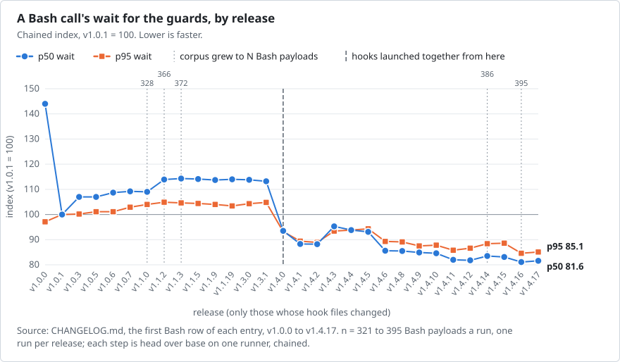

# Claude Code Harness

Hooks, settings and rules for Claude Code, and the skills from
[claude-code-skills](https://github.com/AdityaRon/claude-code-skills) at a pinned
release, installed into `~/.claude` once per machine, so they apply in every project without touching repo files.
PreToolUse guards deny what is hard to undo or leaks secrets (force pushes,
`rm -rf` of home or root, reading `.env`, writing a token to disk), and a few
asks remain where shared state changes (cluster writes and secret reads, through
native ask rules; writes to this harness's own config; `disk-space.py` deleting old job
tmp entries or Bazel output bases). Everything else is left
to Claude Code's auto mode and its classifier. The guards that auto mode may now
cover run in shadow mode until 2026-11-29: in auto mode they log what they would
have decided and decide nothing; in any other mode they decide as before
([docs/shadow-mode.md](docs/shadow-mode.md), #237). Every deny
and ask is a line in `~/.claude/logs/audit.log`.

## What it does, what it costs

Each number below carries its n and where it was measured, as of v1.4.17. They
live in `docs/data/readme-numbers.json`, and `python3 tools/readme-figures.py --write`
writes this table and the figures under [Evidence](#evidence); a release does not
refresh them, a person does. Other machines will differ: each release's
`CHANGELOG.md` entry carries a same-run table against the previous tag
(`.github/workflows/release.yml`). The always-approved asks are gone, and the
kubectl one is a native ask rule (#237).

<!-- readme-figures:summary:begin -->
| What | Measured | n | Where and when | Details |
|---|---|---|---|---|
| **Guards on a Bash call** | p50 62.6 ms, p95 114.2 ms (62.2 and 113.5 at v1.4.16, same run) | 395 Bash payloads, the first of two runs | CI runner, Linux, AMD EPYC 9V74, release workflow; 2026-11-20 | [v1.4.17](CHANGELOG.md#v1417-2026-11-20), [releases.md](docs/releases.md) |
| **Asks kept only where people say no** | 849 of 872 guard asks approved over 49 days, the median one holding its call 133 s; in a later 30 days, still before the removal, 476 asks and 1 rejection | 872 asks; 476 asks | One machine's transcripts; then a personal machine's; 2026-08-18 to 2026-10-06; 30 days to 2026-11-15 | [permission-friction.md](docs/permission-friction.md), [#237](https://github.com/AdityaRon/claude-code-harness/issues/237) |
| **One dispatcher, fewer process starts** | `bash-guards.sh` execs per payload 24.53 → 21.98 at v1.4.16 | 400 payloads (395 Bash, 5 Monitor), one run | CI runner, Linux, AMD EPYC 9V74, under strace -f; 2026-11-20 | [v1.4.16](CHANGELOG.md#v1416-2026-11-20), [budgets](tests/guard-execs.test.sh) |
| **Guard wait in real use** | Slowest guard per Bash call: median 0.74 s on v1.4.9; on v1.4.14, 0.26 s over the last 300 calls and 0.41 s over all since install, p90 3.02 and 3.79 s | 1,000 calls (v1.4.9); 300 and 1,337 calls (v1.4.14) | The work Mac, from the guard timing log; doc written 2026-11-19, n added 2026-11-20 | [long-running-sessions.md](docs/long-running-sessions.md#measured-with-n) |
| **Restart from a handoff** | 3 sessions kept 8 to 9 weeks reached 343 to 395 MB of transcript each; restarted from a handoff, live transcripts were 6.9 to 14.5 MB | 3 sessions before; after, not given | The work Mac, about 15 background sessions; no window given; doc written 2026-11-19 | [long-running-sessions.md](docs/long-running-sessions.md#restart-from-a-handoff-not-from-the-transcript) |
| **A long heredoc under UTF-8** | interpreter-guard on a 13 KB, 260-line heredoc: 155 s before #304, 0.29 s after | not given | Apple M2, macOS 26.6.2, bash 3.2.57, en_US.UTF-8; the 155 s at load 4 to 7; 2026-11-20 | [#304](https://github.com/AdityaRon/claude-code-harness/pull/304) |
<!-- readme-figures:summary:end -->

On your own machine, `bash doctor.sh --latency` reads each hook's wall time per day from
Claude Code's transcripts and the Bash guards' timing log (`--days N`, or `--since 2026-10-19`), `bash doctor.sh --census` counts claude processes and their memory,
and `bash doctor.sh --disk` sizes job folders and Bazel output bases.

### Evidence

<!-- readme-figures:figure-wait:begin -->
<picture>
  <source media="(prefers-color-scheme: dark)" srcset="docs/figures/bash-wait-index-dark.svg">
  
</picture>

Each point chains one release's ratio, head over base from its entry's first run on one CI runner, onto the one before; milliseconds differ by runner and are not compared across releases. Source: CHANGELOG.md, the first Bash row of each entry, v1.0.0 to v1.4.17; n = 321 to 395 Bash payloads a run. 20 releases changed no hook file, were not benchmarked and are left out. From v1.4.0 the benchmark launches the hooks together; earlier ratios ran them one at a time, so the chain crosses a change in what wait means.
<!-- readme-figures:figure-wait:end -->

<!-- readme-figures:table-wait:begin -->
<details><summary>Every release's Bash row, and the index it gives</summary>

| Release | vs | Bash payloads | p50 wait, ms | p95 wait, ms | p50 index | p95 index | Hooks launched | Runner |
|---|---|---:|---|---|---:|---:|---|---|
| v1.0.0 | | | | | 144.0 | 97.1 | | |
| v1.0.1 | v1.0.0 | 321 | 75.6 → 52.5 | 96.5 → 99.4 | 100.0 | 100.0 | one at a time | Linux 6.17.0-1022-azure x86_64, AMD EPYC 7763 64-Core Processor |
| v1.0.3 | v1.0.2 | 321 | 51.5 → 55.1 | 95.9 → 96.1 | 107.0 | 100.2 | one at a time | Linux 6.17.0-1022-azure x86_64, AMD EPYC 7763 64-Core Processor |
| v1.0.5 | v1.0.4 | 321 | 51.6 → 51.6 | 93.2 → 94.0 | 107.0 | 101.1 | one at a time | Linux 6.17.0-1022-azure x86_64, AMD EPYC 7763 64-Core Processor |
| v1.0.6 | v1.0.5 | 321 | 50.7 → 51.5 | 92.3 → 92.3 | 108.7 | 101.1 | one at a time | Linux 6.17.0-1022-azure x86_64, AMD EPYC 7763 64-Core Processor |
| v1.0.7 | v1.0.6 | 321 | 42.3 → 42.5 | 76.4 → 77.8 | 109.2 | 102.9 | one at a time | Linux 7.0.0-1017-azure x86_64, AMD EPYC 9V45 96-Core Processor |
| v1.1.0 | v1.0.8 | 328 | 61.1 → 61.0 | 108.9 → 110.0 | 109.0 | 104.0 | one at a time | Linux 7.0.0-1017-azure x86_64, AMD EPYC 7763 64-Core Processor |
| v1.1.2 | v1.1.1 | 366 | 53.7 → 56.1 | 95.2 → 96.1 | 113.9 | 104.9 | one at a time | Linux 6.17.0-1022-azure x86_64, AMD EPYC 7763 64-Core Processor |
| v1.1.3 | v1.1.2 | 372 | 56.9 → 57.1 | 99.1 → 98.8 | 114.3 | 104.6 | one at a time | Linux 6.17.0-1022-azure x86_64, AMD EPYC 7763 64-Core Processor |
| v1.1.5 | v1.1.4 | 372 | 58.1 → 58.0 | 99.9 → 99.7 | 114.1 | 104.4 | one at a time | Linux 6.17.0-1022-azure x86_64, AMD EPYC 7763 64-Core Processor |
| v1.1.9 | v1.1.8 | 372 | 61.2 → 61.0 | 104.3 → 103.9 | 113.7 | 104.0 | one at a time | Linux 7.0.0-1017-azure x86_64, AMD EPYC 7763 64-Core Processor |
| v1.1.19 | v1.1.18 | 372 | 69.0 → 69.2 | 118.6 → 117.9 | 114.0 | 103.4 | one at a time | Linux 7.0.0-1019-azure x86_64, AMD EPYC 7763 64-Core Processor |
| v1.3.0 | v1.2.0 | 372 | 52.5 → 52.4 | 89.9 → 90.7 | 113.8 | 104.3 | one at a time | Linux 7.0.0-1019-azure x86_64, INTEL(R) XEON(R) PLATINUM 8573C |
| v1.3.1 | v1.3.0 | 372 | 58.5 → 58.2 | 99.8 → 100.3 | 113.2 | 104.8 | one at a time | Linux 7.0.0-1019-azure x86_64, AMD EPYC 9V74 80-Core Processor |
| v1.4.0 | v1.3.1 | 372 | 77.0 → 63.6 | 121.6 → 108.1 | 93.5 | 93.2 | together | Linux 7.0.0-1019-azure x86_64, AMD EPYC 9V45 96-Core Processor |
| v1.4.1 | v1.4.0 | 372 | 87.2 → 82.3 | 148.6 → 142.6 | 88.3 | 89.4 | together | Linux 7.0.0-1019-azure x86_64, AMD EPYC 7763 64-Core Processor |
| v1.4.2 | v1.4.1 | 372 | 82.9 → 82.8 | 143.2 → 142.4 | 88.2 | 88.9 | together | Linux 7.0.0-1019-azure x86_64, AMD EPYC 7763 64-Core Processor |
| v1.4.3 | v1.4.2 | 372 | 72.6 → 78.5 | 125.2 → 131.5 | 95.3 | 93.4 | together | Linux 7.0.0-1019-azure x86_64, INTEL(R) XEON(R) PLATINUM 8573C |
| v1.4.4 | v1.4.3 | 372 | 73.5 → 72.3 | 122.8 → 123.3 | 93.8 | 93.8 | together | Linux 7.0.0-1019-azure x86_64, AMD EPYC 9V74 80-Core Processor |
| v1.4.5 | v1.4.4 | 372 | 56.4 → 56.0 | 95.3 → 95.8 | 93.1 | 94.3 | together | Linux 7.0.0-1016-aws x86_64, Intel(R) Xeon(R) 6975P-C |
| v1.4.6 | v1.4.5 | 372 | 56.1 → 51.6 | 96.2 → 91.1 | 85.6 | 89.3 | together | Linux 7.0.0-1016-aws x86_64, Intel(R) Xeon(R) 6975P-C |
| v1.4.8 | v1.4.7 | 372 | 79.3 → 79.2 | 142.8 → 142.5 | 85.5 | 89.1 | together | Linux 7.0.0-1019-azure x86_64, AMD EPYC 7763 64-Core Processor |
| v1.4.9 | v1.4.8 | 372 | 65.1 → 64.6 | 119.1 → 117.0 | 84.9 | 87.5 | together | Linux 7.0.0-1019-azure x86_64, AMD EPYC 9V74 80-Core Processor |
| v1.4.10 | v1.4.9 | 372 | 82.1 → 81.8 | 147.0 → 147.5 | 84.6 | 87.8 | together | Linux 7.0.0-1019-azure x86_64, AMD EPYC 7763 64-Core Processor |
| v1.4.11 | v1.4.10 | 372 | 66.1 → 64.1 | 118.6 → 115.9 | 82.0 | 85.8 | together | Linux 7.0.0-1019-azure x86_64, Intel(R) Xeon(R) Platinum 8370C CPU @ 2.80GHz |
| v1.4.12 | v1.4.11 | 372 | 65.0 → 64.8 | 115.3 → 116.4 | 81.8 | 86.6 | together | Linux 7.0.0-1019-azure x86_64, INTEL(R) XEON(R) PLATINUM 8573C |
| v1.4.14 | v1.4.13 | 386 | 62.2 → 63.5 | 114.2 → 116.5 | 83.5 | 88.4 | together | Linux 7.0.0-1019-azure x86_64, AMD EPYC 9V74 80-Core Processor |
| v1.4.15 | v1.4.14 | 386 | 63.0 → 62.7 | 115.5 → 115.8 | 83.1 | 88.6 | together | Linux 7.0.0-1019-azure x86_64, AMD EPYC 9V74 80-Core Processor |
| v1.4.16 | v1.4.15 | 395 | 63.3 → 61.8 | 118.4 → 113.0 | 81.1 | 84.6 | together | Linux 7.0.0-1019-azure x86_64, AMD EPYC 9V74 80-Core Processor |
| v1.4.17 | v1.4.16 | 395 | 62.2 → 62.6 | 113.5 → 114.2 | 81.6 | 85.1 | together | Linux 7.0.0-1019-azure x86_64, AMD EPYC 9V74 80-Core Processor |

Not benchmarked, because `hooks/` and `config/settings.json` were unchanged: v1.0.2, v1.0.4, v1.0.8, v1.1.1, v1.1.4, v1.1.6, v1.1.7, v1.1.8, v1.1.10, v1.1.11, v1.1.12, v1.1.13, v1.1.14, v1.1.15, v1.1.16, v1.1.17, v1.1.18, v1.2.0, v1.4.7, v1.4.13.

</details>
<!-- readme-figures:table-wait:end -->

<!-- readme-figures:figure-execs:begin -->
<picture>
  <source media="(prefers-color-scheme: dark)" srcset="docs/figures/bash-guards-execs-dark.svg">
  
</picture>

Execs are execve calls past bash-guards.sh's own bash, each payload run once under strace -f. On the same corpus the count matched across runners, so these compare across releases where the corpus did not change. Source: CHANGELOG.md launches tables, v1.4.11 (the first) to v1.4.17; n = 377 to 400 payloads a run. Per-shape budgets: tests/guard-execs.test.sh.
<!-- readme-figures:figure-execs:end -->

<!-- readme-figures:table-execs:begin -->
<details><summary>bash-guards.sh execs per payload, by release</summary>

| Release | vs | payloads | execs per payload | Runner |
|---|---|---:|---|---|
| v1.4.11 | v1.4.10 | 377 | 25.59 → 23.78 | Linux 7.0.0-1019-azure x86_64, Intel(R) Xeon(R) Platinum 8370C CPU @ 2.80GHz |
| v1.4.12 | v1.4.11 | 377 | 23.78 → 23.78 | Linux 7.0.0-1019-azure x86_64, INTEL(R) XEON(R) PLATINUM 8573C |
| v1.4.14 | v1.4.13 | 391 | 23.06 → 23.60 | Linux 7.0.0-1019-azure x86_64, AMD EPYC 9V74 80-Core Processor |
| v1.4.15 | v1.4.14 | 391 | 23.60 → 23.60 | Linux 7.0.0-1019-azure x86_64, AMD EPYC 9V74 80-Core Processor |
| v1.4.16 | v1.4.15 | 400 | 24.53 → 21.98 | Linux 7.0.0-1019-azure x86_64, AMD EPYC 9V74 80-Core Processor |
| v1.4.17 | v1.4.16 | 400 | 21.98 → 21.98 | Linux 7.0.0-1019-azure x86_64, AMD EPYC 9V74 80-Core Processor |

</details>
<!-- readme-figures:table-execs:end -->

Where each summary row comes from:

<!-- readme-figures:sources:begin -->
| Row | Source | Command |
|---|---|---|
| Guards on a Bash call | [CHANGELOG.md](CHANGELOG.md#v1417-2026-11-20), v1.4.17, the first Bash row | `.github/bench-gate.sh v1.4.16` in `.github/workflows/release.yml`, which runs `tools/hook-bench.py --gate` |
| Asks kept only where people say no | [docs/permission-friction.md](docs/permission-friction.md); [#237](https://github.com/AdityaRon/claude-code-harness/issues/237), Measured inputs | `tools/permission-friction.py --days 49`; `tools/permission-friction.py --days 30` |
| One dispatcher, fewer process starts | [CHANGELOG.md](CHANGELOG.md#v1416-2026-11-20), v1.4.16, the launches table | `tools/hook-bench.py --launches strace`, through `.github/bench-gate.sh v1.4.15` |
| Guard wait in real use | [docs/long-running-sessions.md](docs/long-running-sessions.md#measured-with-n) | read from `guard-timing.log`; `bash doctor.sh --latency` reads the same log |
| Restart from a handoff | [docs/long-running-sessions.md](docs/long-running-sessions.md#restart-from-a-handoff-not-from-the-transcript) | `ls -lS ~/.claude/projects/*/*.jsonl | head` |
| A long heredoc under UTF-8 | [PR #304](https://github.com/AdityaRon/claude-code-harness/pull/304), After; the 155 s also in `tests/guard-latency.test.sh` | the heredoc in `tests/guard-latency.test.sh` through `hooks/interpreter-guard.sh` |
<!-- readme-figures:sources:end -->

## Install and update

Needs macOS or Linux with bash, `jq` (the guards fail closed without it), `gh`,
`python3` (for `tools/hook-bench.py` and `tools/permission-friction.py`; 3.10 or
newer with a TOML reader for the comms-hub and skill-forge skills) and `claude`.

```bash
git clone https://github.com/AdityaRon/claude-code-harness.git
cd claude-code-harness
bash install.sh
```

- Merges into your `~/.claude/settings.json`: your keys kept, allow, ask and deny lists unioned, the harness's hook entries owned by the harness.
- Backs the previous file up as `settings.json.bak.<timestamp>` and folds in `~/.claude/local-settings/*.json`.
- Clones claude-code-skills into `~/.claude/skills-src` at the release
  `config/skills.pin` names, verifies its commit and runs its `install.sh`
  (`bin/skills-sync.sh`). If that fetch fails, the installed skills stay as
  they were, the install says so and finishes, and `harness-update.sh` retries.
- Runs `doctor.sh` to verify every hook.

**A fork, or a fresh copy.** Clone your own copy instead, then run
`tools/fork-setup.sh` from it. It reports what GitHub needs before this repo's
workflows run: Actions on, the workflows GitHub turns off on a fork back on,
Actions allowed to open pull requests (Release and Upstream drift open them),
and the `CLAUDE_CODE_OAUTH_TOKEN` secret. `tools/fork-setup.sh --apply` turns on
what is off; the secret you set yourself, with `/install-github-app` in Claude
Code.

Then run `/hooks` in Claude Code to confirm everything is registered. On a new
machine, put your `~/.claude/rules/local-*.md` and `~/.claude/local-settings/`
files in place first; this public repo ships neither. More in
[docs/install.md](docs/install.md), including what lands in `~/.claude`.

**Updating.** `~/.claude/harness-update.sh` checks the newest release tag out
of its own clone, runs `doctor.sh --smoke` (`--full`: every suite), and installs
only on green; `--schedule` runs
it at 01:17, 07:17, 13:17 and 19:17 local time and `--unschedule` stops that.
`--with-cli` also upgrades a Homebrew-cask Claude Code on each run. It leaves
alone an install from a clone with local changes or commits, so update that
one with `git pull && bash install.sh`. Releases are `vMAJOR.MINOR.PATCH` tags, each
with a GitHub Release and a `CHANGELOG.md` entry. The Release workflow tags
main after each daily Upstream drift run when anything but `CHANGELOG.md`
changed, gated on `doctor.sh` and, when `hooks/` or `config/settings.json`
changed, the hook benchmark: [docs/releases.md](docs/releases.md).

**Keeping up with Claude Code.** Claude Code auto-updates, so what the harness
relies on (hook events, the permission mode, memory index limits) is checked daily
for breakage by `tools/upstream-check.sh`: [docs/upstream-contract.md](docs/upstream-contract.md).

**Testing.** `bash doctor.sh` runs every suite in `tests/`; a new suite sources
`tests/lib.sh` for `pass` and `fail`. `--smoke` runs the few in `tests/smoke.list`
that name every wired hook, which is what `install.sh` runs (`install.sh --full`
runs all). A suite gets 30 minutes (`CCH_SUITE_TIMEOUT`); the summary lists wall
times slowest first and names a suite stopped by a signal KILLED and one past its
limit TIMEOUT, apart from failures. CI runs doctor on Linux and macOS, lints
the scripts and suites with shellcheck, compiles every Python file with macOS's /usr/bin/python3 (3.9),
and benchmarks each PR's hooks against main. The suites that read the skills
(`tests/skills-sync.test.sh`, `tests/token-shapes.test.sh` and part of
`tests/heredoc-openers.test.sh`) take them from a claude-code-skills clone at the
pinned commit, `$CCH_SKILLS_CLONE` or `~/.claude/skills-src`; without one they
skip, except in CI, which clones it.

## What it blocks, asks and logs

| Hook | Runs on | Behaviour |
|---|---|---|
| `bash-guards` | Bash, Monitor | Runs the seven Bash guards below as one hook: one parse of the call, each guard a fork, deny over ask over allow. A guard that dies is a deny naming it. `~/.claude/hooks/bash-guards.skip` switches one off ([docs/guards.md](docs/guards.md)) |
| `env-guard` | Bash | Deny: reading, dumping, copying or sending env values and dotfiles (`cat .env`, `printenv`, `nc`). Shadow: a bare `env` |
| `sensitive-file-guard` | Read, Grep, file writes | Deny: `.env`, keys, SSH and cloud credentials, credential folders. Ask: a Grep at or above your home folder |
| `secret-scanner` | file writes | Deny: high-confidence token shapes (AWS, GitHub, Slack, Stripe, Google, Anthropic, OpenAI, PEM) in written content |
| `git-guard` | Bash | Deny: force push in any spelling, `reset --hard`, `clean -f`, hook tampering, a broad `git add` that would stage a credential file or that it cannot check. Ask: deleting a remote branch whose tip no other ref holds, remote changes, stash drop. Runs: local branch deletes, `worktree remove --force`, identity and signing config |
| `rm-guard` | Bash | Deny: recursive `rm` of home, root or a top-level folder. Ask: `disk-space.py` with `--apply`, in any spelling. Shadow: `rm -rf` outside the session's scratch folder |
| `config-guard` | Bash, file writes | Ask: writes to installed hooks, settings, the Bash guards' skip file, shell startup files, `~/.gitconfig`, LaunchAgents, Bash writes into a mod Claude Code loads by itself, and copies or extractions into a `.claude` folder. Deny: moving or emptying `~/.claude` |
| `network-guard` | Bash | Deny: file uploads and pipe-to-shell. Ask: edits to the machine-local network allowlist. Shadow: request bodies, `DELETE`, `curl`/`wget` to hosts off the allowlist, `scp`/`rsync`, local servers. WebFetch is not guarded |
| `interpreter-guard` | Bash | Shadow: inline code (`python -c`, `node -e`, heredocs) that touches env, dotfiles, sockets or an env-dumping command, and long inline scripts. Auto mode drops `Bash(python3:*)`, so its classifier sees them |
| `kubectl-guard` | Bash | Asks on a Secret read in any spelling (`get Secret`, `describe secret`, a kind from xargs), on kubeconfig credentials and on kubectl behind a function. Its other verb rules are in shadow: read verbs are allowed by prefix, and native ask rules in `config/settings.json` ask before every mutating verb, verb first or flags first |
| `subagent-cache-guard` | a subagent's tool calls, SubagentStop | Deny: a subagent's tool calls once its prompt cache went cold 5 times in one run (`CLAUDE_SUBAGENT_MAX_COLD_STARTS`), until it replies with where it got to. Main sessions are left alone |
| `mod-gate` | file writes | Deny: a mod hooking `tool.check` or another permission override. Ask: a mod it cannot review. Anything else it hooks or calls, outside the guards included, is shown in a notice |
| `audit` | most events | Log: edits, Bash, MCP calls (field names only), agents, messages, artifacts, failures, auto-mode denials, model switches, settings changes, session end |
| `memory-lint` | file writes | Advise: name, type, description, `verify:` block and index tier of a memory file. In a `trackers/` folder, only a marked handoff: its shape, size, `STATE:` stamp and `Crons:`, and lines telling a session to read a ledger over 20 KB first; ledgers, reports and archives are not linted (`CLAUDE_TRACKER_LINT=off`) |
| `memory-lint-stop` | Stop | Advise at the end of the turn: a memory still with no index line, or a handoff whose `STATE:` is older than its write (the two-write saves `memory-lint` defers) |
| `comment-budget` | file writes | Advise: a comment block an edit grew past 6 lines |
| `tcc-check` | Bash results and failures | Advise: names macOS privacy control (TCC) when a Bash call prints an "Operation not permitted" error (a tool's, zsh's or python's) for a path in `~/Desktop`, `~/Documents`, `~/Downloads` or iCloud Drive, or for no path while the cwd (or a `cd` in the command) is in one. A line quoting one, in backticks or after grep -n's `file:line:`, is not an error; a log line printed whole still is |
| `session-start` | SessionStart | Inject: branch, status and recent commits; on resume, files that drifted since the last session; once a day, a warning when job folders or Bazel output bases pass a size |
| `session-snapshot` | Stop, SessionEnd | Record: hashes of the files the session edited, for the resume drift check |
| `pre-compact` | PreCompact | Back up: the transcript before compaction, one per session, newest 20 within 1000 MB |
| `notify` | Notification | Notify: a desktop alert titled with the session name |
| `plan-to-html` | ExitPlanMode | Render: the plan as HTML in your browser, without delaying the prompt |
| status line | every refresh | Show: model and effort, branch, context, cost, rate limits, plan and workflow links, a cold-cache warning |

A guard's deny runs before the permission system, so it holds in every
permission mode (a loaded mod is the exception). A guard's ask still comes to
you in auto mode: Claude Code's [permission-modes doc](https://code.claude.com/docs/en/permission-modes)
says auto mode "still shows you those prompts". The auto-mode classifier
decides only what no guard or rule names. "Shadow" above means the guard or rule
logs what it would have decided to `~/.claude/logs/shadow.log` and decides
nothing; the list is `hooks/lib/shadow.sh`, and `tools/shadow-report.py` shows
what the classifier or a native rule did instead. Every row in full:
[docs/guards.md](docs/guards.md), [docs/hooks.md](docs/hooks.md),
[docs/auto-mode.md](docs/auto-mode.md).

## Turning things off and customizing

What `install.sh` does with a value you set, from `config/merge-settings.jq`:

| Setting | Shipped | Install keeps yours? |
|---|---|---|
| `permissions.defaultMode` | `auto` | No: replaced on every install, with a notice |
| `permissions.allow`, `permissions.deny` | scoped lists | Yes: unioned with the shipped lists, minus `config/retired-rules.json` |
| `hooks` | the harness's entries | Yours kept; the harness's own entries rewritten |
| `statusLine` | `~/.claude/statusline.sh` | No: rewritten on every install |
| `sandbox` | off, with a domain allowlist | Yes, per key; a list you set replaces the shipped list |
| `env` | audit log, transcript folder, `CLAUDE_CODE_AUTO_COMPACT_WINDOW` | Yes, per key |
| `effortLevel` | `high` | Yes, after one move of an installed `xhigh` to `high` (marker `~/.claude/state/effort-high.migrated`) |
| `autoDreamEnabled` | `true` | Yes: `false` keeps auto-dream off ([docs/memory.md](docs/memory.md)) |
| `syncClaudeAiSkills`, `syncClaudeAiPlugins` | `false` | Yes |
| `remoteControlAtStartup` and the other top-level switches ([docs/permissions.md](docs/permissions.md)) | `true` | Yes |

- **A Bash guard off:** put its name on a line of `~/.claude/hooks/bash-guards.skip` (`kubectl-guard`, say); `config-guard` asks before Claude writes that file. Names off the shipped list are ignored, so the file can only switch guards off ([docs/guards.md](docs/guards.md)).
- **Any other hook off:** there is no per-hook switch. Deleting its entry from `~/.claude/settings.json` lasts until the next install. To keep it off, remove it from `config/settings.json` in your clone; `harness-update.sh` leaves an install from a changed clone alone, so update with `git pull && bash install.sh`.
- **Auto mode off:** `claude --permission-mode manual` for one session. Every install rewrites `permissions.defaultMode`, so to keep it off set `"manual"` in your clone's `config/settings.json`, as for a hook.
- **Your own hooks:** a script in `~/.claude/hooks` under a name this repo does not use, plus its entry in `~/.claude/settings.json`. Installs keep both.
- **Allow rules for work tools:** `~/.claude/local-settings/<name>.json`; only its `permissions.allow` and `permissions.deny` are read.
- **Hosts:** `~/.claude/net-allowlist.sh candidates 30` lists, from the audit log, hosts network-guard asked about in 30 days; `add <host>` allows GETs to it, `add --body <host>` request bodies too; `list` and `remove` show and drop entries.
- **Environment knobs**, under `env` in settings unless noted:
  - `CLAUDE_AUDIT_LOG`: where the audit log goes.
  - `CLAUDE_PLANS_HTML_DIR`, `CLAUDE_PLAN_HTML_NO_OPEN=1`: where plans render, and whether a browser opens.
  - `CLAUDE_EDITOR_URI`: the editor the status line's `wf` link opens.
  - `CLAUDE_NET_ALLOWLIST`: extra hosts for network-guard, per project.
  - `CLAUDE_CODE_AUTO_COMPACT_WINDOW`: when auto-compact fires; a bare integer.
  - `CCH_KEEP_BACKUPS`, in the shell that runs `install.sh`: how many `settings.json` backups it keeps (default 10).
  - `CLAUDE_DISK_WARN_JOBS_GB`, `CLAUDE_DISK_WARN_BAZEL_GB`: the sizes of `~/.claude/jobs` and the Bazel output root that session-start warns past (default 50 and 100).
- **Sandbox:** run `~/.claude/sandbox.sh on`, `off` or `status` yourself (a `!` message or a terminal), then ask Claude to run `~/.claude/sandbox-trial.sh`.

Each of these in full: [docs/customization.md](docs/customization.md).

## Skills

The skills live in [claude-code-skills](https://github.com/AdityaRon/claude-code-skills),
split out of this repo at 6699a5c: comms-hub and slack-draft (one session speaks
on Slack for all of them, with a panel mod beside its chat), skill-forge (one
skill per recurring question in a new job), pr-review, memory-audit and
memory-archive. Their protocols, tests and changelog are there.

- `config/skills.pin` names the release this harness installs: its URL, tag and
  commit. `install.sh` and `harness-update.sh` both install it through
  `bin/skills-sync.sh`, so `harness-update.sh` stays the one entry point.
  `HARNESS_SKILLS_URL` points at another clone of it, as `HARNESS_UPDATE_URL`
  does for this repo; `HARNESS_SKILLS_CLONE` moves `~/.claude/skills-src`.
- That repo's `install.sh` owns `~/.claude/skills` and skill-forge's templates in
  `~/.local/share/skill-forge/`, and records what it wrote in
  `~/.claude/skills.manifest`. This repo writes nothing there and removes nothing
  there (`tools/pickup-report.sh`).
- Several skills run tools this repo installs in `~/.claude`: `memory-verify.sh`,
  `memory-index.sh`, `session-route.sh` and `spend-report.py`.
- `bash doctor.sh --skill comms-hub` runs that skill's prerequisite check from
  `~/.claude/skills-src`.

## Verifying a change

Opt in: nothing here runs from a hook.

- `bash doctor.sh --changed [BASE]` diffs the working tree, uncommitted and untracked
  files included, against its merge base with BASE (default `origin/main`). It prints
  the rows of `config/verify-checklist.tsv` the change matches, always as "K of N rows
  matched", and the suites that cover the changed files. A README or docs/ file maps
  to the suites that read it, not those that only quote its name. `--run` runs those suites;
  `--stamp` also prints a `Verified:` line naming each with its tally, and none when
  one fails. `--changed HEAD` reads only what is not committed yet.
- Each row cites the incident it comes from, and its check is suites (`run:`) or a
  step to do by hand (`do:`). The table is read from the merge base with `origin/main`,
  whatever BASE is, plus rows new in the branch, so a branch cannot drop or narrow its own rows.
- In a session in this clone, `/verify` (`.claude/skills/verify`) walks the same
  steps, and Claude uses it before a commit or a PR in place of the full `doctor.sh`.
  Its one-line description loads only in sessions in this clone; its body when it is used.
- A commit's `Verified:` trailer names what ran, or says `Verified: none (<why>)`.
  CI's "verification stamps" job lists a PR's commits without one in its summary
  (`tools/verify-stamp.sh`) and passes. `config/verify.conf` on the base branch sets
  the mode: `observe` now; `enforce` would fail the job.

## Design choices

- The guards keep what auto mode cannot see or should not judge: file reads it never classifies, commands an allow rule may pass before the classifier, and actions that cannot be undone. A hook sees the whole command and a permission rule sees a prefix or a space-wildcard pattern, so those checks live in the guards; native ask rules cover kubectl writes and secret reads, and the classifier judges the rest ([docs/permissions.md](docs/permissions.md)).
- Guards fail closed: no jq or unparsable input denies (`tests/fail-closed.test.sh`), and a crash or timeout blocks through `"onFailure": "block"` (Claude Code 2.1.295 and later). Inside `bash-guards`, a guard that dies is a deny naming it, and an early exit of the hook itself is made exit 2 (`tests/bash-guards.test.sh`).
- No `autoMode` block ships: setting a category appears to replace Claude Code's own rules for it, 72 `soft_deny` rules by `claude auto-mode defaults` on 2.1.325 ([docs/auto-mode.md](docs/auto-mode.md)).
- Every deny and ask is an audit line; MCP calls are logged, not guarded ([docs/hooks.md](docs/hooks.md)).
- The memory tools propose and never delete ([docs/memory.md](docs/memory.md)), and what it relies on in Claude Code is checked daily for breakage ([docs/upstream-contract.md](docs/upstream-contract.md)).
- Sessions kept for days restart from a short handoff rather than resuming a transcript that only grows; the harness measures transcripts, nudges at session start and caps its own backups ([docs/long-running-sessions.md](docs/long-running-sessions.md)).

## Known limitations

- Regex guards can be evaded by a determined agent; the OS sandbox is the real containment. Guard hardening is frozen as of 2026-11-15, so a bypass of a guard's regex is a known limitation rather than a fix.
- A Claude Code mod (2.1.287+) can override the guards; `mod-gate` reviews only mods written through the file tools, and `config-guard` asks before a Bash write into one Claude Code loads by itself.
- MCP connectors are logged, not guarded.
- In auto mode the classifier, by judgment, decides everything no guard or rule names.

More, including what fails closed: [docs/known-limitations.md](docs/known-limitations.md).

## Repo layout

The install and test entry points, the changelog and the license sit at the root;
everything else is grouped by what it is.

```
install.sh  doctor.sh    ← install once per machine; run every suite in tests/
CHANGELOG.md             ← one entry per release
LICENSE                  ← MIT
.claude/skills/verify/   ← /verify in a session in this clone (doctor.sh --changed, then the stamp);
                           not installed
bin/                     ← every file installed flat to ~/.claude by install.sh
  statusline.sh  harness-update.sh  net-allowlist.sh  sandbox.sh  sandbox-trial.sh
  skills-sync.sh         ← installs the claude-code-skills release config/skills.pin names
  memory-verify.sh  memory-fix.sh  memory-index.sh  memory-provenance.sh
  session-route.sh       ← which session owns this PR (docs/session-routing.md)
  relocate-clones.sh     ← moves a clone out of ~/Desktop, ~/Documents or ~/Downloads (docs/known-limitations.md)
  spend-report.py        ← what sessions, subagents and loop ticks cost, and what caused each context
                           rewrite (a lapsed cache TTL, a compaction), from local transcripts
  disk-space.py          ← what job folders and Bazel output bases hold (report, bazel); harness-update.sh
                           records the totals, large transcripts and the guards' p90 once a day for
                           session-start's warnings (doctor.sh --disk);
                           prune, clone and bazel --sweep list what is safe to delete and delete it by digest
  tracker-prune.py       ← moves a tracker's settled rows to <name>-archive.md beside it; a dry run unless --write
tools/                   ← run from the clone only, by CI, releases and whoever maintains a fork
  upstream-check.sh      ← the daily breakage check
  fork-setup.sh          ← what a fork's GitHub settings need before the workflows run
  hook-bench.py  release-notes.sh  ← the release benchmark and notes
  guard-props.py         ← property checks: guard fast paths, inert heredocs, count_mark (docs/guards.md)
  permission-friction.py ← which guard asks and denies cost the most, from local transcripts
  hook-latency.py        ← each hook's wall time per day, from local transcripts (doctor.sh --latency)
  hooknames.py           ← names the hook a transcript record numbers, for the two above: by the guard
                           whose words are in the reason on its own stdout, else by settings.json
  shadow-report.py       ← what each shadowed guard or rule would have decided, and what happened instead
  session-census.py      ← claude processes, their memory, and idle background jobs (doctor.sh --census;
                           --sizes adds disk-space.py's report)
  pickup-report.sh       ← after an install, how running sessions pick up each change; install.sh runs it with
                           --prune, which removes what install wrote that the clone deleted
  verify-changed.sh      ← the checklist rows and suites a branch's changes call for (doctor.sh --changed)
  verify-stamp.sh        ← a PR's commits with no Verified: trailer, for CI's job summary
  readme-figures.py      ← README.md's summary table, evidence tables and docs/figures/ charts, from
                           docs/data/readme-numbers.json and CHANGELOG.md up to the release it cites
config/                  ← settings.json, merge-settings.jq, retired-rules.json, upstream-contract.json,
                           skills.pin, verify-checklist.tsv, verify.conf
hooks/                   ← one file per hook, plus lib.sh, which sources lib/: command, paths,
                           scratch, io, inline, net, host and shadow; bash-guards.sh runs the Bash guards
rules/                   ← installed to ~/.claude/rules, loaded in every session
  prose-and-comments.md  collaboration.md  working-agreement.md  environment.md
  python-tests.md        ← path-scoped: loads only when Claude opens Python or a file under tests/
tests/                   ← <name>.test.sh for most hooks, tools and .github scripts; host-binary covers
                           tcc-check and the host check; install-*, fail-closed, guard-latency,
                           heredoc-openers, prompt-canary, repo-layout, shadow, token-shapes and
                           workflow-gates cut across files; guard-execs holds git-guard and
                           interpreter-guard to a process budget per corpus shape; readme-numbers
                           holds README.md's numbers to the files they cite; lib.sh is their
                           shared pass/fail; lib/transcripts.py writes synthetic transcripts at test
                           time (no real one is committed), and prompt-canary checks that no report
                           on them prints prompt text; bench-corpus.jsonl feeds hook-bench; doctor
                           tests doctor.sh's own report; smoke.list is the set install.sh and
                           harness-update.sh verify with (doctor.sh --smoke)
docs/
  install.md  releases.md  upstream-contract.md  guards.md  hooks.md
  permissions.md  auto-mode.md  customization.md  known-limitations.md
  memory.md              ← what Claude Code's memory does now, and each harness tool's verdict
  session-routing.md     ← routing a PR to its session; holds only in single-author repos
  permission-friction.md ← which guard asks and denies cost the most, and why
  shadow-mode.md         ← the guards and rules on trial (#237): what they log, how step 9 reads the report
  long-running-sessions.md ← keeping sessions alive for days: transcripts, handoffs, crons, process cost, disk
  permission-friction-cases.jsonl  ← cases tools/permission-friction.py --cases replays
  history/               ← superseded memory research the memory skills still cite
  data/readme-numbers.json ← every number README.md's tables and charts show, with n, source and command
  figures/               ← README.md's charts, light and dark, written by tools/readme-figures.py
```

Everything here is portable because the repo is public; machine-local rules and
allow rules live in `~/.claude/rules/local-*.md` and `~/.claude/local-settings/`
([docs/customization.md](docs/customization.md)).

## License

MIT, in [LICENSE](LICENSE).
