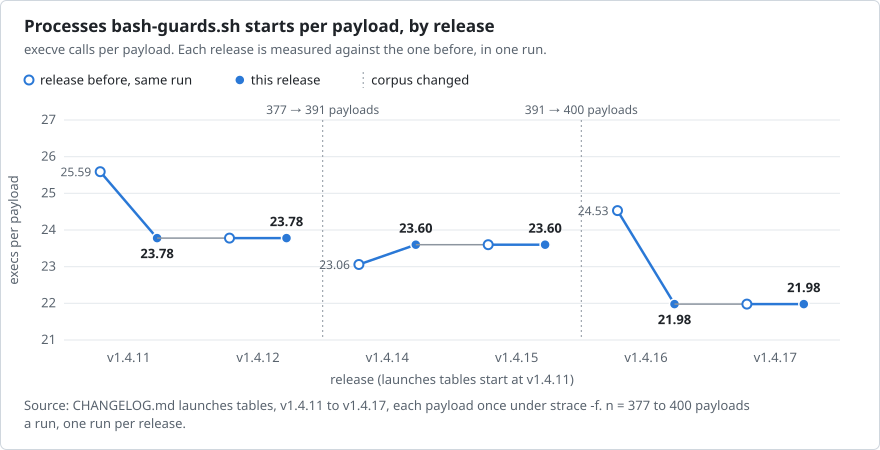

# Claude Code Harness

Guards and hooks for Claude Code, installed once per machine: deny what cannot
be undone, ask where shared state changes, log the rest, and measure what each
costs.

<!-- readme-figures:hero:begin -->
<picture>
  <source media="(prefers-color-scheme: dark)" srcset="docs/figures/hero-dark.svg">
  
</picture>
<!-- readme-figures:hero:end -->

A hook sees the whole command, where a permission rule sees a prefix or a
pattern, so the checks that must read all of it live in the guards. A guard's
deny runs before Claude Code's permission system and holds in every mode. The
exceptions are a loaded mod and, in auto mode until the 2026-11-29 review, the
guards and rules on trial in [shadow mode](docs/shadow-mode.md). An ask costs a
person minutes, so the asks that were always approved are gone
([#237](https://github.com/AdityaRon/claude-code-harness/issues/237)), and auto
mode's classifier decides what no guard or rule names.

## What it does, what it costs

<!-- readme-figures:summary:begin -->
| What | Measured | n | Where and when | Details |
|---|---|---|---|---|
| **Guards on a Bash call** | Wait p50 62.2 → 62.6 ms, p95 113.5 → 114.2 ms (v1.4.16 → v1.4.17, same run) | 395 Bash payloads, one run | CI runner, Linux, AMD EPYC 9V74; 2026-11-20 | [v1.4.17](CHANGELOG.md#v1417-2026-11-20), [releases.md](docs/releases.md) |
| **Always-approved asks removed** | 849 of 872 guard asks approved over 49 days, the median one holding its call 133 s; then 476 asks and 1 rejection in 30 days | 872 asks; 476 asks | One machine's transcripts, then a personal machine's; 2026-08-18 to 2026-10-06, then 30 days to 2026-11-15 | [permission-friction.md](docs/permission-friction.md), [#237](https://github.com/AdityaRon/claude-code-harness/issues/237) |
| **One dispatcher, fewer process starts** | `bash-guards.sh` execs per payload 24.53 → 21.98 at v1.4.16 | 400 payloads (395 Bash, 5 Monitor), one run | CI runner, Linux, AMD EPYC 9V74, strace -f; 2026-11-20 | [v1.4.16](CHANGELOG.md#v1416-2026-11-20), [budgets](tests/guard-execs.test.sh) |
| **Guard wait in real use** | Slowest guard per Bash call: median 0.74 s on v1.4.9, 0.26 to 0.41 s on v1.4.14; the slowest 10% still wait 3 s or more | not given | Real use, from the guard timing log; the doc names no machine or window; doc written 2026-11-19 | [long-running-sessions.md](docs/long-running-sessions.md#every-process-a-hook-starts-costs-more-on-a-managed-machine) |
| **Restart from a handoff** | 3 sessions kept 8 to 9 weeks reached 343 to 395 MB of transcript each; restarted from a handoff, live transcripts were 6.9 to 14.5 MB | 3 sessions before; after, not given | The work Mac, about 15 background sessions; doc written 2026-11-19 | [long-running-sessions.md](docs/long-running-sessions.md#restart-from-a-handoff-not-from-the-transcript) |
| **A long heredoc under UTF-8** | interpreter-guard on a 13 KB, 260-line heredoc: 155 s before #304, 0.29 s after | not given | Apple M2, macOS 26.6.2, bash 3.2.57, en_US.UTF-8; the 155 s at load 4 to 7; 2026-11-20 | [#304](https://github.com/AdityaRon/claude-code-harness/pull/304) |
<!-- readme-figures:summary:end -->

Measured on the machines named, as of v1.4.17; yours will differ. The numbers
live in [`docs/data/readme-numbers.json`](docs/data/readme-numbers.json), and a
person refreshes them with `python3 tools/readme-figures.py --write`, not each
release. Charts and full tables are under [Evidence](#evidence).

## Check your own machine

A self-check that installs with the harness is coming in a separate change.
Until then, from a clone: `bash doctor.sh --latency` reads each hook's wall
time per day from Claude Code's transcripts and the guards' timing log,
`bash doctor.sh --census` counts claude processes and their memory, and
`bash doctor.sh --disk` sizes job folders and Bazel output bases.

## Install

```bash
git clone https://github.com/AdityaRon/claude-code-harness.git
cd claude-code-harness
bash install.sh
```

It merges into `~/.claude/settings.json`, keeping your keys, installs the skills
from [claude-code-skills](https://github.com/AdityaRon/claude-code-skills) at a
pinned release, and checks every hook. Requirements, updating, forks and what
lands in `~/.claude`: [docs/install.md](docs/install.md).

## The seven Bash guards

`bash-guards` parses each Bash and Monitor call once and forks these in
parallel; a deny beats an ask, and an ask beats an allow.

| Guard | Deny | Ask | Shadow |
|---|---|---|---|
| `env-guard` | reading, dumping, copying or sending env values and dotfiles (`cat .env`, `printenv`, `nc`) | | a bare `env` |
| `git-guard` | force push in any spelling, `reset --hard`, `clean -f`, hook tampering, a broad `git add` it cannot check | deleting a remote branch no other ref holds, remote changes, stash drop | |
| `interpreter-guard` | | | inline code (`python -c`, `node -e`, heredocs) that touches env, dotfiles or sockets, and long inline scripts |
| `kubectl-guard` | | a Secret read in any spelling, kubeconfig credentials, kubectl behind a function | its verb rules; native ask rules ask before every mutating verb |
| `network-guard` | file uploads and pipe-to-shell | edits to the network allowlist | request bodies, `DELETE`, hosts off the allowlist, `scp` and `rsync` |
| `rm-guard` | recursive `rm` of home, root or a top-level folder | `disk-space.py --apply` | `rm -rf` outside the session's scratch folder |
| `config-guard` | moving or emptying `~/.claude` | writes to installed hooks, settings, shell startup files, `~/.gitconfig`, LaunchAgents and mods | |

Shadow means the rule logs what it would have decided and decides nothing, in
auto mode only, until the 2026-11-29 review. Each guard in full:
[docs/guards.md](docs/guards.md). The file guards, the session hooks and every
other hook: [docs/hooks.md](docs/hooks.md).

## Limits and not measured

- Regex guards can be evaded by a determined agent; the OS sandbox is the
  containment. Guard hardening is frozen as of 2026-11-15, so a bypass is a
  known limitation, not a fix.
- A Claude Code mod can override the guards, and MCP connectors are logged, not
  guarded.
- In auto mode the classifier decides, by judgment, everything no guard or rule
  names.
- The release benchmark runs on CI runners, where a process starts far faster
  than on a managed Mac ([docs/long-running-sessions.md](docs/long-running-sessions.md)),
  so its numbers are likely a floor for such a machine (inferred, not measured).
- Not measured:
  - how many asks there have been since the always-approved ones were removed;
  - the machine, n and window behind the guard wait in real use, and how many
    sessions the after-handoff transcript sizes cover;
  - each release's guard cost on a Mac, since the release benchmark runs only
    on CI;
  - the n behind the heredoc row's two timings, and the old code on bash 5:
    #304 timed it on bash 3.2 only.

More: [docs/known-limitations.md](docs/known-limitations.md).

## Evidence

<!-- readme-figures:figure-wait:begin -->
<picture>
  <source media="(prefers-color-scheme: dark)" srcset="docs/figures/bash-wait-index-dark.svg">
  
</picture>

Each point chains one release's ratio, head over base from its entry's first run on one CI runner, onto the one before; milliseconds differ by runner and are not compared across releases. Source: CHANGELOG.md, the first Bash row of each entry, v1.0.0 to v1.4.17; n = 321 to 395 Bash payloads a run. 20 releases changed no hook file, were not benchmarked and are left out.
<!-- readme-figures:figure-wait:end -->

<!-- readme-figures:table-wait:begin -->
<details><summary>Every release's Bash row, and the index it gives</summary>

| Release | vs | Bash payloads | p50 wait, ms | p95 wait, ms | p50 index | p95 index | Hooks launched | Runner |
|---|---|---:|---|---|---:|---:|---|---|
| v1.0.0 | | | | | 144.0 | 97.1 | | |
| v1.0.1 | v1.0.0 | 321 | 75.6 → 52.5 | 96.5 → 99.4 | 100.0 | 100.0 | one at a time | Linux 6.17.0-1022-azure x86_64, AMD EPYC 7763 64-Core Processor |
| v1.0.3 | v1.0.2 | 321 | 51.5 → 55.1 | 95.9 → 96.1 | 107.0 | 100.2 | one at a time | Linux 6.17.0-1022-azure x86_64, AMD EPYC 7763 64-Core Processor |
| v1.0.5 | v1.0.4 | 321 | 51.6 → 51.6 | 93.2 → 94.0 | 107.0 | 101.1 | one at a time | Linux 6.17.0-1022-azure x86_64, AMD EPYC 7763 64-Core Processor |
| v1.0.6 | v1.0.5 | 321 | 50.7 → 51.5 | 92.3 → 92.3 | 108.7 | 101.1 | one at a time | Linux 6.17.0-1022-azure x86_64, AMD EPYC 7763 64-Core Processor |
| v1.0.7 | v1.0.6 | 321 | 42.3 → 42.5 | 76.4 → 77.8 | 109.2 | 102.9 | one at a time | Linux 7.0.0-1017-azure x86_64, AMD EPYC 9V45 96-Core Processor |
| v1.1.0 | v1.0.8 | 328 | 61.1 → 61.0 | 108.9 → 110.0 | 109.0 | 104.0 | one at a time | Linux 7.0.0-1017-azure x86_64, AMD EPYC 7763 64-Core Processor |
| v1.1.2 | v1.1.1 | 366 | 53.7 → 56.1 | 95.2 → 96.1 | 113.9 | 104.9 | one at a time | Linux 6.17.0-1022-azure x86_64, AMD EPYC 7763 64-Core Processor |
| v1.1.3 | v1.1.2 | 372 | 56.9 → 57.1 | 99.1 → 98.8 | 114.3 | 104.6 | one at a time | Linux 6.17.0-1022-azure x86_64, AMD EPYC 7763 64-Core Processor |
| v1.1.5 | v1.1.4 | 372 | 58.1 → 58.0 | 99.9 → 99.7 | 114.1 | 104.4 | one at a time | Linux 6.17.0-1022-azure x86_64, AMD EPYC 7763 64-Core Processor |
| v1.1.9 | v1.1.8 | 372 | 61.2 → 61.0 | 104.3 → 103.9 | 113.7 | 104.0 | one at a time | Linux 7.0.0-1017-azure x86_64, AMD EPYC 7763 64-Core Processor |
| v1.1.19 | v1.1.18 | 372 | 69.0 → 69.2 | 118.6 → 117.9 | 114.0 | 103.4 | one at a time | Linux 7.0.0-1019-azure x86_64, AMD EPYC 7763 64-Core Processor |
| v1.3.0 | v1.2.0 | 372 | 52.5 → 52.4 | 89.9 → 90.7 | 113.8 | 104.3 | one at a time | Linux 7.0.0-1019-azure x86_64, INTEL(R) XEON(R) PLATINUM 8573C |
| v1.3.1 | v1.3.0 | 372 | 58.5 → 58.2 | 99.8 → 100.3 | 113.2 | 104.8 | one at a time | Linux 7.0.0-1019-azure x86_64, AMD EPYC 9V74 80-Core Processor |
| v1.4.0 | v1.3.1 | 372 | 77.0 → 63.6 | 121.6 → 108.1 | 93.5 | 93.2 | together | Linux 7.0.0-1019-azure x86_64, AMD EPYC 9V45 96-Core Processor |
| v1.4.1 | v1.4.0 | 372 | 87.2 → 82.3 | 148.6 → 142.6 | 88.3 | 89.4 | together | Linux 7.0.0-1019-azure x86_64, AMD EPYC 7763 64-Core Processor |
| v1.4.2 | v1.4.1 | 372 | 82.9 → 82.8 | 143.2 → 142.4 | 88.2 | 88.9 | together | Linux 7.0.0-1019-azure x86_64, AMD EPYC 7763 64-Core Processor |
| v1.4.3 | v1.4.2 | 372 | 72.6 → 78.5 | 125.2 → 131.5 | 95.3 | 93.4 | together | Linux 7.0.0-1019-azure x86_64, INTEL(R) XEON(R) PLATINUM 8573C |
| v1.4.4 | v1.4.3 | 372 | 73.5 → 72.3 | 122.8 → 123.3 | 93.8 | 93.8 | together | Linux 7.0.0-1019-azure x86_64, AMD EPYC 9V74 80-Core Processor |
| v1.4.5 | v1.4.4 | 372 | 56.4 → 56.0 | 95.3 → 95.8 | 93.1 | 94.3 | together | Linux 7.0.0-1016-aws x86_64, Intel(R) Xeon(R) 6975P-C |
| v1.4.6 | v1.4.5 | 372 | 56.1 → 51.6 | 96.2 → 91.1 | 85.6 | 89.3 | together | Linux 7.0.0-1016-aws x86_64, Intel(R) Xeon(R) 6975P-C |
| v1.4.8 | v1.4.7 | 372 | 79.3 → 79.2 | 142.8 → 142.5 | 85.5 | 89.1 | together | Linux 7.0.0-1019-azure x86_64, AMD EPYC 7763 64-Core Processor |
| v1.4.9 | v1.4.8 | 372 | 65.1 → 64.6 | 119.1 → 117.0 | 84.9 | 87.5 | together | Linux 7.0.0-1019-azure x86_64, AMD EPYC 9V74 80-Core Processor |
| v1.4.10 | v1.4.9 | 372 | 82.1 → 81.8 | 147.0 → 147.5 | 84.6 | 87.8 | together | Linux 7.0.0-1019-azure x86_64, AMD EPYC 7763 64-Core Processor |
| v1.4.11 | v1.4.10 | 372 | 66.1 → 64.1 | 118.6 → 115.9 | 82.0 | 85.8 | together | Linux 7.0.0-1019-azure x86_64, Intel(R) Xeon(R) Platinum 8370C CPU @ 2.80GHz |
| v1.4.12 | v1.4.11 | 372 | 65.0 → 64.8 | 115.3 → 116.4 | 81.8 | 86.6 | together | Linux 7.0.0-1019-azure x86_64, INTEL(R) XEON(R) PLATINUM 8573C |
| v1.4.14 | v1.4.13 | 386 | 62.2 → 63.5 | 114.2 → 116.5 | 83.5 | 88.4 | together | Linux 7.0.0-1019-azure x86_64, AMD EPYC 9V74 80-Core Processor |
| v1.4.15 | v1.4.14 | 386 | 63.0 → 62.7 | 115.5 → 115.8 | 83.1 | 88.6 | together | Linux 7.0.0-1019-azure x86_64, AMD EPYC 9V74 80-Core Processor |
| v1.4.16 | v1.4.15 | 395 | 63.3 → 61.8 | 118.4 → 113.0 | 81.1 | 84.6 | together | Linux 7.0.0-1019-azure x86_64, AMD EPYC 9V74 80-Core Processor |
| v1.4.17 | v1.4.16 | 395 | 62.2 → 62.6 | 113.5 → 114.2 | 81.6 | 85.1 | together | Linux 7.0.0-1019-azure x86_64, AMD EPYC 9V74 80-Core Processor |

Not benchmarked, because `hooks/` and `config/settings.json` were unchanged: v1.0.2, v1.0.4, v1.0.8, v1.1.1, v1.1.4, v1.1.6, v1.1.7, v1.1.8, v1.1.10, v1.1.11, v1.1.12, v1.1.13, v1.1.14, v1.1.15, v1.1.16, v1.1.17, v1.1.18, v1.2.0, v1.4.7, v1.4.13.

</details>
<!-- readme-figures:table-wait:end -->

<!-- readme-figures:figure-execs:begin -->
<picture>
  <source media="(prefers-color-scheme: dark)" srcset="docs/figures/bash-guards-execs-dark.svg">
  
</picture>

Execs are execve calls past bash-guards.sh's own bash, each payload run once under strace -f. On the same corpus the count matched across runners, so these compare across releases where the corpus did not change. Source: CHANGELOG.md launches tables, v1.4.11 (the first) to v1.4.17; n = 377 to 400 payloads a run. Per-shape budgets: tests/guard-execs.test.sh.
<!-- readme-figures:figure-execs:end -->

<!-- readme-figures:table-execs:begin -->
<details><summary>bash-guards.sh execs per payload, by release</summary>

| Release | vs | payloads | execs per payload | Runner |
|---|---|---:|---|---|
| v1.4.11 | v1.4.10 | 377 | 25.59 → 23.78 | Linux 7.0.0-1019-azure x86_64, Intel(R) Xeon(R) Platinum 8370C CPU @ 2.80GHz |
| v1.4.12 | v1.4.11 | 377 | 23.78 → 23.78 | Linux 7.0.0-1019-azure x86_64, INTEL(R) XEON(R) PLATINUM 8573C |
| v1.4.14 | v1.4.13 | 391 | 23.06 → 23.60 | Linux 7.0.0-1019-azure x86_64, AMD EPYC 9V74 80-Core Processor |
| v1.4.15 | v1.4.14 | 391 | 23.60 → 23.60 | Linux 7.0.0-1019-azure x86_64, AMD EPYC 9V74 80-Core Processor |
| v1.4.16 | v1.4.15 | 400 | 24.53 → 21.98 | Linux 7.0.0-1019-azure x86_64, AMD EPYC 9V74 80-Core Processor |
| v1.4.17 | v1.4.16 | 400 | 21.98 → 21.98 | Linux 7.0.0-1019-azure x86_64, AMD EPYC 9V74 80-Core Processor |

</details>
<!-- readme-figures:table-execs:end -->

Where each row of the summary table comes from:

<!-- readme-figures:sources:begin -->
| Row | Source | Command |
|---|---|---|
| Guards on a Bash call | [CHANGELOG.md](CHANGELOG.md#v1417-2026-11-20), v1.4.17, the first Bash row | `.github/bench-gate.sh v1.4.16` in `.github/workflows/release.yml`, which runs `tools/hook-bench.py --gate` |
| Always-approved asks removed | [docs/permission-friction.md](docs/permission-friction.md); [#237](https://github.com/AdityaRon/claude-code-harness/issues/237), Measured inputs | `tools/permission-friction.py --days 49`; `tools/permission-friction.py --days 30` |
| One dispatcher, fewer process starts | [CHANGELOG.md](CHANGELOG.md#v1416-2026-11-20), v1.4.16, the launches table | `tools/hook-bench.py --launches strace`, through `.github/bench-gate.sh v1.4.15` |
| Guard wait in real use | [docs/long-running-sessions.md](docs/long-running-sessions.md#every-process-a-hook-starts-costs-more-on-a-managed-machine) | not given in the doc; `bash doctor.sh --latency` reads the same log |
| Restart from a handoff | [docs/long-running-sessions.md](docs/long-running-sessions.md#restart-from-a-handoff-not-from-the-transcript) | `ls -lS ~/.claude/projects/*/*.jsonl | head` |
| A long heredoc under UTF-8 | [PR #304](https://github.com/AdityaRon/claude-code-harness/pull/304), After; the 155 s also in `tests/guard-latency.test.sh` | the heredoc in `tests/guard-latency.test.sh` through `hooks/interpreter-guard.sh` |
<!-- readme-figures:sources:end -->

## Docs

[Install](docs/install.md) · [Releases and updating](docs/releases.md) ·
[Hooks](docs/hooks.md) · [Guards](docs/guards.md) ·
[Customization](docs/customization.md) · [Permissions](docs/permissions.md) ·
[Auto mode](docs/auto-mode.md) · [Shadow mode](docs/shadow-mode.md) ·
[Known limitations](docs/known-limitations.md) · [Verifying a change](docs/verify.md) ·
[Design choices](docs/design.md) · [Repo layout](docs/layout.md) ·
[Memory](docs/memory.md) · [Long-running sessions](docs/long-running-sessions.md) ·
[Permission friction](docs/permission-friction.md) ·
[Session routing](docs/session-routing.md) ·
[Keeping up with Claude Code](docs/upstream-contract.md) · [Changelog](CHANGELOG.md)

## License

MIT, in [LICENSE](LICENSE).
